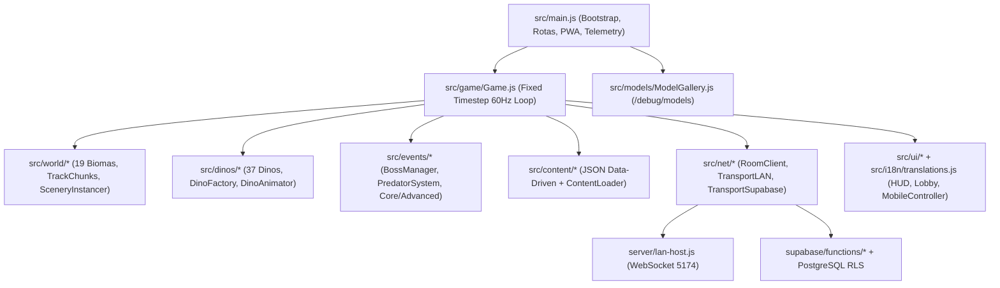

# Arquitetura do Sistema & Guia de Extensão — DINO DASH 3D

## 1. Visão Geral da Arquitetura

---

## 2. Guia Passo a Passo: Como Adicionar Novo Conteúdo

### 2.1 Como Adicionar um Novo Boss
1. **Dados (`src/content/bosses.json`):** Adicione o objeto do boss com `id`, `name`, `biomeId`, `hp`, `rewardEggs` e o array `phases` (3 fases com `phase: 1|2|3`, `hpThreshold`, `pattern`, `telegraphSec`).
2. **Modelo 3D (`src/events/BossModels.js`):** Adicione um `case '<id>':` em `buildBossModel(bossId)` retornando `createCommonState(...)` com `setPhase(1|2|3)`.
3. **Validação:** Rode `npm run test:unit` (valida o schema via `ContentLoader.validateContent()`) e abra `/debug/models` para inspecionar as 3 fases em 3D.

### 2.2 Como Adicionar uma Nova Missão ou Evento Sazonal
1. **Missão (`src/content/missions.json`):** Adicione um item com `{ id, scope: "daily"|"weekly"|"campaign", title, metric, target, rewardEggs }`.
2. **Evento Sazonal (`src/content/seasonal_events.json`):** Adicione `{ id, name, startMM, startDD, endMM, endDD, accent, bonusMult }`.
3. **Validação:** `npm run test:unit`.

### 2.3 Como Adicionar um Novo Modo de Jogo
1. **Catálogo (`src/game/Modes.js`):** Adicione a definição em `GAME_MODES` (`id`, `tier: 'essential'|'advanced'|'bonus'`, `name`, `players`, `desc`).
2. **Regras (`src/game/Game.js`):** Se o modo tiver condição especial de vitória/derrota ou HUD próprio, trate `this.modeId === '<id>'` em `startRun()` e `_updatePlaying()`.

### 2.4 Como Adicionar um Novo Modelo Voxel / Dinossauro
1. **Catálogo (`src/dinos/DinoCatalog.js`):** Adicione a espécie em `DINO_CATALOG` (`id`, `name`, `dinoClass`, `habitat`, `stats`, `ability`).
2. **Malha Voxel (`src/dinos/DinoFactory.js`):** Adicione os blocos em `DinoFactory.buildDino(id, customization)` mantendo o orçamento de **<= 750 triângulos** (`docs/ARTE.md`).
3. **Inspeção:** Acesse `http://127.0.0.1:4173/debug/models` para girar o modelo e testar as animações (`run`, `jump`, `duck`, `hurt`, `victory`).
